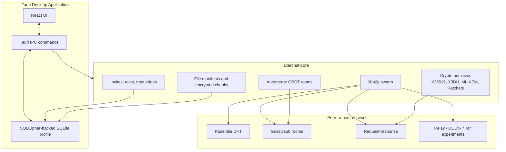

<div align="center">
  <h1>AlterChat</h1>
  <p><strong>Local-first, peer-to-peer, zero-trust communication workspace</strong></p>

  [](https://github.com/onurbaydas/AlterChat/actions/workflows/ci.yml)
  [](https://github.com/onurbaydas/AlterChat/actions/workflows/codeql.yml)
  [](https://github.com/onurbaydas/AlterChat/releases/latest)
  [](https://github.com/onurbaydas/AlterChat/releases)
  [](https://scorecard.dev/viewer/?uri=github.com/onurbaydas/AlterChat)
  [](https://www.rust-lang.org/)
  [](https://tauri.app/)
  [](https://react.dev/)
  [](LICENSE)

  **[⬇ İndir / Download](https://github.com/onurbaydas/AlterChat/releases/latest)** ·
  **[▶ Canlı demo / Live demo](https://onurbaydas.github.io/AlterChat/)** ·
  **[💬 Discussions](https://github.com/onurbaydas/AlterChat/discussions)**
</div>

---

## Overview

AlterChat is an experimental secure messaging stack built around a simple
principle: identity, history, policy, and keys should belong to the user, not to
a central service.

The repository combines a Rust/libp2p protocol core with a Tauri desktop
application. The current implementation focuses on local-first encrypted
profiles, peer discovery, CRDT-backed rooms, direct messages, trust controls,
role-based room governance, file chunking, WebRTC signaling, onion packet
experiments, and a small bootstrap daemon for community-run discovery nodes.

This is security-sensitive software and should be treated as an alpha-stage
research implementation until it has received independent review. The codebase
contains real cryptographic building blocks, but the protocol and application
surface are still evolving.

## Table of Contents

- [Download and Install](#download-and-install)
- [Why AlterChat](#why-alterchat)
- [Current Capabilities](#current-capabilities)
- [Repository Layout](#repository-layout)
- [Architecture at a Glance](#architecture-at-a-glance)
- [Security Posture](#security-posture)
- [Quick Start](#quick-start)
- [Running the Desktop App](#running-the-desktop-app)
- [Running a Bootstrap Node](#running-a-bootstrap-node)
- [Operational Concepts](#operational-concepts)
- [Development Workflow](#development-workflow)
- [Documentation Map](#documentation-map)
- [Project Status](#project-status)
- [License](#license)
- [Support](#support)

## Download and Install

**Kullanıcılar için (Türkçe):** [Releases](https://github.com/onurbaydas/AlterChat/releases/latest)
sayfasından işletim sisteminize uygun dosyayı indirin:

| Sistem | Dosya |
| --- | --- |
| Windows 10/11 | `AlterChat_x.y.z_x64-setup.exe` (yönetici izni istemez) |
| macOS | `AlterChat_x.y.z_*.dmg` |
| Linux | `.AppImage` veya `.deb` |

Kurup açın, "Yeni sığınak kur" ile bir takma ad ve şifre belirleyin, ardından
davet bağlantınızı arkadaşlarınıza gönderin. Yeni sürümler çıktığında uygulama
açılışta haber verir ve tek tıkla güncellenir (güncellemeler imzalıdır).

**For users (English):** download the installer for your OS from the
[latest release](https://github.com/onurbaydas/AlterChat/releases/latest),
create a profile, and share your invite link. The app checks for signed
updates on startup and installs them with one click.

> Windows may show a SmartScreen "unknown publisher" warning until the
> installer is code-signed: choose *More info → Run anyway*.

**Önce denemek ister misiniz? / Try before installing:** the
[live demo](https://onurbaydas.github.io/AlterChat/) runs the real interface in
your browser against a simulated network. Nothing leaves your browser.

Maintainers: see [RELEASING.md](RELEASING.md).

## Why AlterChat

Most chat systems hide complexity behind accounts, service operators, and
central message stores. AlterChat goes in the opposite direction:

- **No central account authority:** a peer identity is derived from a local
  libp2p Ed25519 keypair.
- **Local-first storage:** profiles, settings, rooms, private messages, trust
  edges, room roles, file manifests, and plugin records live in a local SQLite
  database opened through SQLCipher support.
- **Peer-to-peer network model:** libp2p provides Kademlia, mDNS, Identify,
  Gossipsub, request-response, relay, DCUtR, TCP, QUIC, Noise, and Yamux.
- **Human-verifiable trust:** contacts can be given local trust levels, blocked,
  muted, verified with safety numbers, and connected through signed trust edges.
- **Defense-in-depth design:** transport encryption, profile encryption, message
  encryption, optional traffic padding, proof-of-work primitives, and onion
  packet experiments are kept as separate layers.
- **No silent cloud fallback:** the app is designed around explicit peer
  routing, local configuration, and community bootstrap nodes.

## Current Capabilities

### Messaging

- Global CRDT room named `alterchat-global`.
- Joinable/savable group rooms with optional room passwords.
- Direct peer messages with local message history.
- Message TTL support in the UI and local cleanup path.
- Search index for room and DM text.
- Anonymous channel command path for temporary room identifiers.

### Identity and Profiles

- Profiles stored under the OS app-data directory in
  `profiles/<random-id>/` (`keypair.bin`, `db.salt`, `profile.db`, `storage/`).
  Nothing on disk is derived from the password.
- SQLCipher key = Argon2id(password, per-profile random salt), passed as a raw
  256-bit key.
- Explicit "create" vs "unlock": a mistyped password never creates a profile.
- Amnesic mode: throwaway profile in a temp directory with a random key, removed
  on exit and on the next start.
- Encrypted libp2p keypair loading/generation.
- X25519 offline public key generation for peer bootstrap and safety numbers.
- `alterchat://connect?peer=...&pk=...` URI generation.

### Cryptography

- Ed25519 identity keys through libp2p.
- X25519 public-key encryption for peer payloads.
- AES-256-GCM for local encrypted payloads and file chunks.
- Argon2id-based file encryption helpers.
- X3DH-style shared-secret generation with ML-KEM-768 hybrid material.
- Double Ratchet implementation with skipped-message handling.
- Simpler symmetric ratchet compatibility path for current DM flows.
- Safety number derivation from peer public keys.
- Sealed-sender style encrypted envelope helpers.

### Networking

- libp2p Kademlia DHT for discovery and records.
- mDNS for local-network zero-configuration discovery.
- Gossipsub for room CRDT state publication.
- request-response protocol for files, DMs, capabilities, plugin events, PoW
  messages, WebRTC signaling, and onion forwarding.
- NAT traversal: clients reserve circuit relay v2 slots on up to two relays
  (bootstrap nodes first), publish their relayed addresses in a signed DHT
  record, and upgrade relayed connections to direct ones with DCUtR hole
  punching. See [Internet Connectivity](#internet-connectivity).
- Tor transport plus relay circuits through Tor, so Tor users can be reached.
- Tor transport integration through the vendored `libp2p-community-tor` crate.
- QUIC transport preference path.
- SOCKS5 proxy transport (outbound only, fail closed): TCP multiaddrs
  (`/ip4`, `/ip6`, `/dns*`, `/onion3`) are dialed through a SOCKS5 proxy with
  remote DNS resolution and optional username/password
  (`user:pass@host:port`). No direct TCP, QUIC, local DNS, listeners, mDNS,
  relay server, or hole punching in this mode; an unreachable proxy is an error,
  never a fallback.
- I2P mode (experimental): the same SOCKS5 transport pointed at the I2P
  router's SOCKS proxy (default `127.0.0.1:4447`). It only dials `.i2p` host
  names (`/dns/<name>.b32.i2p/tcp/<port>/p2p/<id>`), so it reaches only peers
  that publish an I2P server tunnel to their libp2p TCP port. Clearnet peers,
  normal bootstrap nodes, and inbound connections are not reachable in this
  mode, and AlterChat does not create I2P tunnels itself (no SAM support).

### Governance and Trust

- Signed invite tokens with expiry, use limits, and permissions.
- Default room roles and signed permission grants.
- Signed trust edges.
- Local trust thresholds for DMs, files, and invites.
- Local peer controls: block, mute, rate limit, and PoW requirement flags.
- Distributed invite revocation record path.

### Files, Media, and Storage

- Ask-before-accept peer-to-peer file transfer: per-file AES-256-GCM key
  sealed to the friend's X25519 key, 256 KiB chunks pulled with a bounded
  window and retries, SHA-256 verified, saved to Downloads without
  overwriting (size, concurrency, trust and quota limits).
- File manifests with 256 KiB chunking.
- AES-256-GCM chunk encryption plus plaintext hash verification.
- Storage quotas and retention settings.
- Local chunk store under `profiles/<id>/storage/`.
- WebRTC signaling over libp2p request-response.
- Experimental media E2EE path using browser insertable streams.
- SFU host election heuristic based on local/peer capacity scores.

### Plugins and Extensibility

- Plugin manifest and capability policy model in `alterchat-core`.
- Sandboxed WASM plugin execution (wasmi interpreter): signature and hash
  verification, fuel and memory limits, no WASI, and capability-gated host
  functions. See [docs/PLUGINS.md](docs/PLUGINS.md) for the ABI.
- Tauri commands to save, list and run plugins (`run_plugin` runs on a blocking
  thread).
- Plugin event request-response messages.
- Plugin execution remains a sensitive extension surface and should be reviewed
  carefully before enabling untrusted code.

## Repository Layout

```text
AlterChat/
├─ alterchat-core/             Rust protocol, crypto, storage, network, governance
├─ alterchat-ui/               Tauri v2 desktop app with React frontend
│  ├─ src/                     React UI, WebRTC helpers, components
│  └─ src-tauri/               Tauri backend, SQLite schema, IPC commands
├─ alterchat-bootstrap/        Headless Kademlia bootstrap node
├─ libp2p-community-tor/       Vendored Tor transport adapter for libp2p
├─ .github/                    CI, release workflow, issue and PR templates
├─ ARCHITECTURE.md             Protocol and module architecture
├─ THREAT_MODEL.md             Threat model and mitigations
├─ SECURITY.md                 Vulnerability reporting policy
└─ CONTRIBUTING.md             Contribution workflow
```

## Architecture at a Glance



The detailed architecture is documented in [ARCHITECTURE.md](ARCHITECTURE.md).

## Security Status

> **Alpha Software — Not Independently Audited**
>
> AlterChat has NOT undergone an independent cryptographic or security audit.
> The cryptographic primitives (X3DH, ML-KEM-768, Double Ratchet) are implemented
> from standard specifications but implementation correctness is unverified.
> Do not use for high-stakes communications until an audit is completed.

Known limitations in v0.1.0:

- Group message rooms (Gossipsub) do not have per-room end-to-end encryption
  in v0.1.0.
- DHT queries and peer connections reveal metadata to network observers.
- Panic wipe uses best-effort file overwrite (SSD wear-leveling may retain
  data).
- Pluggable transport obfuscation (obfs4, Snowflake) is not wired to the
  transport layer.

## Security Posture

AlterChat is designed with strong security goals, but the repository should not
be advertised as audited or production-ready.

Implemented foundations:

- libp2p Noise transport encryption.
- SQLCipher-backed local database opening through `rusqlite`.
- Argon2id and AES-256-GCM helper functions for encrypted local material.
- Ed25519 signatures for governance artifacts.
- X25519 and ML-KEM-768 hybrid material in the X3DH path.
- Double Ratchet module with unit tests for bidirectional and out-of-order
  messages.
- Local trust thresholds, block/mute controls, and rate limiting.
- Traffic padding, chaff payload, and proof-of-work primitives.
- Panic-wipe commands for active profile, message database, or all local
  profiles.

Important limitations:

- No independent security audit has been completed.
- The Tauri CSP is strict (`script-src 'self'`). It still allows
  `'unsafe-inline'` styles because the UI uses inline style objects.
- Some privacy features are experimental or partially wired. I2P mode is
  outbound-only to `.i2p` destinations, and full pluggable transport
  deployment and production-grade relay policy need
  additional implementation review.
- WebRTC media E2EE uses browser APIs that may degrade when peer keys are not
  available.
- The local database key is Argon2id(password, per-profile salt) with default
  Argon2 parameters (19 MiB, t=2). Stronger, tunable parameters are planned.

See [THREAT_MODEL.md](THREAT_MODEL.md) and [SECURITY.md](SECURITY.md).

## Quick Start

### Prerequisites

- **Rust 1.95+**. The current dependency graph uses `sysinfo 0.39.x`, which
  requires Rust 1.95 or newer.
- **Node.js 20+** and npm.
- **Tauri v2 system dependencies** for your platform.
- **Perl** (SQLCipher is built with a vendored OpenSSL). Linux and macOS
  already ship it. On Windows, install
  [Strawberry Perl](https://strawberryperl.com/).
- On Windows, install the **Visual Studio 2022 Build Tools** with the
  "Desktop development with C++" workload (MSVC linker and Windows SDK).
- On Linux, install WebKitGTK and related build packages.

Windows example (PowerShell):

```powershell
winget install Microsoft.VisualStudio.2022.BuildTools --override "--wait --quiet --add Microsoft.VisualStudio.Workload.VCTools --includeRecommended"
winget install StrawberryPerl.StrawberryPerl
```

> On Windows, run cargo from PowerShell or a Developer Prompt. Git Bash puts a
> GNU `link` utility on `PATH`, which can shadow the MSVC linker.

Debian/Ubuntu example:

```bash
sudo apt update
sudo apt install -y \
  build-essential curl wget file libssl-dev \
  libgtk-3-dev libayatana-appindicator3-dev librsvg2-dev \
  libwebkit2gtk-4.1-dev
```

Clone:

```bash
git clone https://github.com/onurbaydas/AlterChat.git
cd AlterChat
```

Check the Rust workspace:

```bash
rustup update stable
cargo check --workspace
```

If `cargo check` fails with a `sysinfo requires rustc 1.95` message, update your
Rust toolchain first.

## Running the Desktop App

```bash
cd alterchat-ui
npm install
npm run tauri dev
```

Build a desktop bundle:

```bash
cd alterchat-ui
npm run tauri build
```

The Tauri build output is created under `alterchat-ui/src-tauri/target/`.

## Running a Bootstrap Node

The bootstrap daemon is intentionally small. It creates a libp2p Kademlia
server node, listens on TCP and QUIC port `4001`, identifies peers, and adds
their listen addresses to the DHT routing table. Its identity is stored in
`ALTERCHAT_DATA_DIR`, so the peer id stays the same across restarts.

```bash
cargo run --package alterchat-bootstrap --release
# or the prebuilt image
docker run -d --name alterchat-bootstrap --restart unless-stopped \
  -p 4001:4001/tcp -p 4001:4001/udp -v alterchat-boot:/data \
  ghcr.io/onurbaydas/alterchat-bootstrap:latest
# or build locally
docker compose -f bootstrap/docker-compose.yml up -d
```

| Variable | Default | Meaning |
| --- | --- | --- |
| `ALTERCHAT_DATA_DIR` | `./bootstrap-data` | directory for the persistent node key |
| `ALTERCHAT_BOOTSTRAP_PORT` | `4001` | TCP and UDP/QUIC listen port |
| `ALTERCHAT_LISTEN_IP` | `0.0.0.0` | IPv4 listen address |
| `ALTERCHAT_RELAY` | `1` | `0` disables the circuit relay v2 service |
| `ALTERCHAT_EXTERNAL_ADDRS` | empty | comma-separated public multiaddrs of the node (e.g. `/dns4/boot.example.org/tcp/4001`) |

The relay service needs at least one external address, because relay clients
reject reservations that carry no relay address. Set
`ALTERCHAT_EXTERNAL_ADDRS` on hosts behind 1:1 NAT (most cloud VMs). Without
it the node advertises listen addresses on public IPs and addresses that two
different peers observed on the listen port. Tor users dial host names only,
so publish a `/dns4/...` address (and give Tor users a `/dns4` bootstrap
entry) if the relay should serve them. Circuits are limited to 10 minutes and
2 MiB each, and every peer can hold two reservations.

Expected output includes a multiaddr similar to:

```text
/ip4/0.0.0.0/tcp/4001/p2p/<PEER_ID>
```

Community bootstrap addresses are currently configured as an empty list in
`alterchat-core/src/network.rs`. Add real community-operated multiaddrs through
reviewed pull requests, not as a central authority.

### Configuring Bootstrap Nodes via Environment Variable

You can supply additional bootstrap nodes at runtime without modifying source
code. Set the `ALTERCHAT_BOOTSTRAP` environment variable to a comma-separated
list of multiaddrs:

```bash
export ALTERCHAT_BOOTSTRAP="\
/ip4/1.2.3.4/tcp/4001/p2p/12D3KooW...,\
/ip4/5.6.7.8/tcp/4001/p2p/12D3KooW..."
cargo run --package alterchat-bootstrap --release
```

These addresses are merged with the hardcoded `COMMUNITY_BOOTSTRAP_ADDRS` list
at startup. User-supplied addresses (via `NetworkPrivacyConfig.bootstrap_addrs`)
take precedence, followed by env-var entries, then the compiled-in list.

## Operational Concepts

### Internet Connectivity

Most home connections are behind NAT, and Tor / SOCKS5 users have no listener
at all, so peers usually cannot dial each other directly. AlterChat handles
this with libp2p circuit relay v2. The switch is **Relay fallback**
(`relay_fallback_enabled`), on by default.

1. On startup the client dials its bootstrap nodes. Each bootstrap node runs a
   relay v2 server.
2. When a connected peer advertises the relay hop protocol, the client
   reserves a circuit on it (`listen_on(<relay>/p2p-circuit)`). It holds up to
   two reservations, bootstrap nodes first. Lost reservations are retried
   every 30 seconds.
3. The relayed address (`<relay addr>/p2p/<relay>/p2p-circuit`) becomes a
   confirmed external address. Identify advertises it, and it is published in
   a signed address record in the DHT under `/alterchat/addr/1/<peer id>`.
   The record is a libp2p `PeerRecord` envelope signed by the peer's identity
   key. DHT nodes and readers reject records that are forged, older than
   24 hours, or older than the copy they already hold. LAN addresses are
   never published.
4. Every 30 seconds the client looks up the address records of friends it is
   not connected to (each friend at most every two minutes). It then dials all
   their addresses at once, direct and relayed, so whichever works first wins.
5. In direct mode, DCUtR then tries to hole-punch a direct connection and
   drops the relay when it succeeds.

Reservations are made whenever relay fallback is on, without an AutoNAT
probe. The bootstrap nodes run no AutoNAT server, AutoNAT cannot work through
Tor or SOCKS5, and a reservation only costs one small stream on a connection
the client already has. AlterChat reports `direct` reachability when a peer
sees it on a public IP that belongs to one of its own interfaces, or when a
peer connects in from a public IP.

**Tor, SOCKS5 and I2P modes.** The relay transport sits on top of the proxy
transport, so the client reaches the relay, and through it other peers, only
via the proxy. Its relayed address contains the relay's address, never its own
IP. Hole punching is turned off in these modes, so connections stay on the
relay circuit. Tor dials host names only (`/dns4/<host>/tcp/<port>/p2p/<id>`),
so Tor users need a DNS-named bootstrap/relay entry.

**What the relay operator sees.** Relayed traffic is end-to-end encrypted
(Noise between the two peers, then the AlterChat protocols on top), so the
relay never sees message contents. It does see:

- the peer ids of both ends of every circuit, and when circuits open and close;
- byte counts and timing of the relayed traffic;
- the IP address each peer connects from (in proxy modes, that is the Tor exit
  or proxy address, not the user's own IP);
- which peers keep reservations on it, and so are online.

The relay can refuse service, drop circuits, or log this metadata. It cannot
read or alter messages, and the signed address records stop it from
redirecting peers to other identities. Relay circuits are limited in time and
volume, so large file transfers over a relay can be cut off.

**UI events.** `network-status` (`online` / `connecting` / `offline`) follows
the number of open connections and pending dials. `network-reachability`
(`direct` / `relayed` / `unreachable`) follows reservations and the direct
heuristic. In SOCKS5/I2P mode, a dial that fails because the proxy is down
raises `session-error` once every 5 minutes at most. In Tor mode,
`session-error` fires after repeated dial failures with no connection left.
When every connection is lost, bootstrap nodes are re-dialed every 30 seconds.

### Profiles

Each profile lives in a random-id directory under the OS app-data directory.
On unlock, the password is checked by decrypting each profile's `keypair.bin`
(Argon2id + AES-256-GCM). The SQLCipher key is then derived with Argon2id from
a per-profile salt. Amnesic mode uses a throwaway temp directory with a random
key. It is intended for sessions that should not leave a durable profile.

### Rooms

Rooms use Automerge CRDT documents. A local room state is saved in SQLite and
published over Gossipsub. Peers merge incoming CRDT bytes and emit UI history
events.

### Direct Messages

Direct messages are sent over libp2p request-response. The codebase contains
both a symmetric ratchet state path and a fuller Double Ratchet module. The X3DH
hybrid handshake path is present and should be the preferred direction for
future protocol hardening.

### Trust

Trust is local by design. Peer trust scores, block/mute state, PoW requirement,
and rate limits are stored in the local database. Signed trust edges can be
created and listed, but users remain responsible for deciding what trust means
for their own device.

### Files

Files can be split into 256 KiB chunks, encrypted with AES-256-GCM, written to a
profile-specific local chunk directory, and indexed by manifest. Retention and
quota controls live in storage settings.

### Panic Wipe

The panic-wipe path attempts to overwrite files with zeroes before deletion and
then exits the process. On modern SSDs, journals, snapshots, cloud sync, and OS
caches can still retain data. Treat panic wipe as best-effort local hygiene, not
forensic erasure.

## Development Workflow

Common checks:

```bash
cargo fmt --all -- --check
cargo clippy --workspace --all-targets -- -D warnings
cargo test --workspace
```

Frontend checks:

```bash
cd alterchat-ui
npm install
npm run build
```

Security-sensitive changes should include tests or a clear manual verification
note. This includes changes to:

- key derivation and encrypted storage
- X3DH, Double Ratchet, sealed sender, or safety numbers
- DHT record keys and peer routing
- SQLite schema or profile migration
- Tauri command allowlists and IPC payloads
- panic wipe or vault import/export
- file chunk encryption and quota enforcement

See [CONTRIBUTING.md](CONTRIBUTING.md) for the full process.

## Documentation Map

- [ARCHITECTURE.md](ARCHITECTURE.md): module-by-module design and event flow.
- [THREAT_MODEL.md](THREAT_MODEL.md): attacker model, mitigations, and open
  risks.
- [SECURITY.md](SECURITY.md): private vulnerability reporting policy.
- [RELEASING.md](RELEASING.md): building and publishing releases, updater keys.
- [CONTRIBUTING.md](CONTRIBUTING.md): development and review workflow.
- [SUPPORT.md](SUPPORT.md): where to ask questions and report problems.
- [alterchat-ui/README.md](alterchat-ui/README.md): desktop frontend details.
- [libp2p-community-tor/README.md](libp2p-community-tor/README.md): Tor
  transport notes and misuse warnings.

## Project Status

AlterChat is an active prototype. The codebase is valuable for experimentation,
local network testing, and protocol development, but it needs hardening before
being trusted for high-risk communication.

Suggested next milestones:

- DMs: bootstrap nodes should validate mailbox records too (only AlterChat
  clients in DHT server mode filter them today); add one-time prekeys.
- Rooms: any room-key holder can edit or delete CRDT entries (edits show as
  unverified, deletes are not detected), and the orphan-change queue is
  unbounded.
- I2P mode still needs SAM-based inbound tunnels (and `.i2p` bootstrap nodes)
  to be useful beyond dialing known `.i2p` peers.
- Plugins: a UI for installing plugins and granting capabilities, and routing
  of incoming `PluginEvent` requests to `run_plugin`.
- File transfer: resume after restart, sending to offline peers, and a
  longer request timeout for slow (Tor) links.
- Ship community bootstrap addresses.
- Add migration tests for SQLite schema evolution.
- Add end-to-end integration tests for two local nodes.
- Document and test bootstrap-node admission policy.
- Run independent cryptographic and Tauri security reviews.

## License

AlterChat is licensed under the [GNU Affero General Public License v3.0](LICENSE).

## Support

If you want to support decentralized, censorship-resistant communication
research, donations are welcome:

- **Monero (XMR):** `43bMdGQAkByAkbiGkgsuGbWf5afr2RBa42swxuqe7M8ohUSVbzaFAQabDivDtLcXJwQDNztZyhMSoiFkSvsCNouV2jACZyA`
- **Bitcoin (BTC):** `bc1q66wc9qq5w5k219ayv9mgm9jc3dkan757a7ufst`
- **Ethereum (ETH / ERC-20):** `0xC47BDDc11F70eb48f3c261186BdAA5A16E4448D0`
